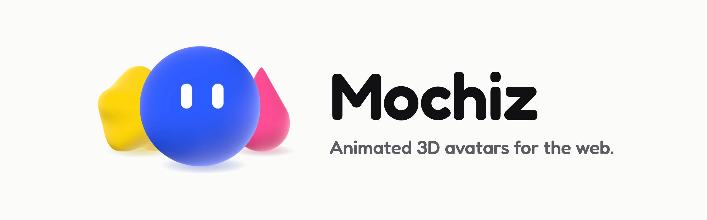

**English** | [Français](README.fr.md)

<picture>
  <source media="(prefers-color-scheme: dark)" srcset="docs/banner-dark.png">
  
</picture>

# Mochiz

[](LICENSE) [**Live demo**](https://mochiz.vercel.app)

Mochiz are small animated characters for the web. One character is called a Mochi: a soft 3D shape with two eyes. It breathes, blinks, shows a mood and reacts when you touch it.

You add a Mochi to any page with one HTML tag, `<mochi-bot>`. It works in plain HTML and in any framework (React, Vue, Svelte, Angular...).

- 12 shapes and 18 colors, or any hex color
- 3 styles, all in real 3D: Soft, Flat and Pixel
- 7 moods, and 5 reactions (to a tap, a double tap, a long press, a shake, and a wave hello)
- 22 accessories you can combine, in the colors you choose
- light and dark themes
- PNG, SVG, GIF and MP4 exports, from the app

**Website:** https://mochiz.vercel.app. The app, an online editor to design a Mochi and export it, is at `/app`.

## Quick start

> The npm package is coming soon. Until then, build the library from this repository: see [Install](docs/getting-started.md#install).

Load the library, then write the tag:

```html live
<script type="module" src="/mochiz/mochiz.js"></script>

<mochi-bot shape="star" color="blue" mood="idle" size="200" wave></mochi-bot>
```

This is the plain HTML way. In an app with a bundler (Vite, webpack...), copy the library into `src/vendor/mochiz/` and write `import './vendor/mochiz/mochiz.js'`: see [Install](docs/getting-started.md#install).

## Documentation

The documentation lives in [docs/](docs/README.md). The website shows the same pages at [/docs](https://mochiz.vercel.app/docs).

- [Getting started](docs/getting-started.md): install, your first Mochi, options, moods, reactions, methods, events, accessories, styles, frameworks.
- [Reference](docs/reference.md): every option, method, event and id.
- [How it works](docs/README.md#how-it-works-for-contributors): architecture and design notes for contributors.

## Development

You need Node.js 22.12 or later (the `engines` field of package.json). The CI runs Node 24.

```bash
npx -y pnpm@11.17.0 install
npx -y pnpm@11.17.0 dev        # http://localhost:5190 (site at /, app at /app.html, lab at /lab.html)
npx -y pnpm@11.17.0 test       # tests (vitest)
npx -y pnpm@11.17.0 build      # type check, then the website in dist/
npx -y pnpm@11.17.0 build:lib  # the library alone, in dist-lib/
```

The code is TypeScript with no framework. The character is a native web component. The website and the app use a small in-house renderer (`src/ui/dom/`). Tools: Vite, Tailwind 4 (app only) and Three.js (loaded on demand). [CHANGELOG.md](CHANGELOG.md) has one entry per version.

## Contributing

Bug reports, ideas and pull requests are welcome. Read [CONTRIBUTING.md](CONTRIBUTING.md) first. Everyone taking part follows the [Code of Conduct](CODE_OF_CONDUCT.md).

## Security

Please do not report security problems in a public issue. See [SECURITY.md](SECURITY.md).

## License

MIT, see [LICENSE](LICENSE).
