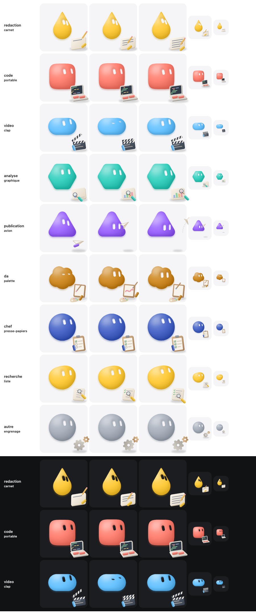

# Accessoires de métier (couche facultative)

`src/bot/accessoires.ts` pose devant un avatar AU TRAVAIL un petit objet animé, dessiné en
code dans le style 3D argile mat (dégradés doux, ombre portée floue, aucun reflet brillant),
et le geste qui va avec : l'avatar regarde son objet, en bas à droite.

Le corps garde EXACTEMENT sa taille et sa place de repos : c'est l'objet qui s'adapte. Il est
posé devant, au premier plan, en léger chevauchement avec le bas du corps et en débordant un
peu du cadre (le client met `overflow: visible` sur le SVG). Rien de sombre n'est posé sous les
yeux, pour qu'un objet ne se lise jamais comme une bouche. Option `geste(t, { echelleCorps })` :
1 par défaut ; sous 1, le corps rapetisse et se range en haut à gauche pour laisser plus de place.

```ts
import { BotEngine } from './engine'
import { accessoireDuMetier } from './accessoires'

const a = accessoireDuMetier('redaction')            // carnet et crayon
const image = bot.sample(t, a.geste(t))
const svg = rendu(image) + a.dessin(t, { uid: 'b1-', corps: teintes3d(couleur, 'argile'), papier: '#f5f5f7' })
```

`dessin(t, options)` rend du SVG en texte dans le repère du moteur (rayon 100, origine au
centre, viewBox de -158 à 158), à poser PAR-DESSUS le corps. Pur, fonction du temps ;
chaque boucle se raccorde sans couture (testé). `uid` préfixe tous les identifiants SVG.
`simple: true` retire les détails fins (mains, rayures, sillage) pour les très petites tailles.
Pour le mouvement réduit, l'application dessine une seule image fixe.



| Métier | Accessoire | Mouvement |
|---|---|---|
| rédaction, guides | `carnet` | le poing tient le crayon, trois lignes s'écrivent (yeux sur la pointe, hochement à chaque retour), petit saut, la page se tourne |
| code, dashboard, scripts | `portable` | écran clair, les poings tapent, chaque ligne s'écrit au curseur suivi des yeux, pastille verte, petit saut |
| vidéo | `clap` | clap clair ; la paume le tient, le poing lève le bras puis claque (corps tassé, yeux plissés), le voyant rouge s'allume |
| analyse | `graphique` | le poing tient la loupe, chaque barre pousse sous le verre (grossie), flèche verte de tendance, petit saut |
| publication | `avion` | élan (corps tassé), lancer (corps étiré), les yeux suivent l'avion, la main rentre dans le corps, coche verte, la main ressort avec un nouvel avion |
| DA | `palette` | trempe le pinceau dans la palette tenue, peint une touche (yeux sur la pointe), petit saut, couleur suivante |
| chef | `presse-papiers` | le crayon tenu coche chaque case, hochement, tout coché : petit saut |
| recherche, SEO, sourcing, QA, vérification | `liste` | la loupe tenue descend la liste (ligne grossie), chaque ligne lue se coche, petit saut |
| autre | `engrenage` | le poing tourne la manivelle (yeux sur la poignée), un tour, pastille verte, petit saut |

## Mains

Deux capsules détachées de la couleur du corps (0,34 x 0,15 rayon) tiennent l'outil. Elles sont
dessinées dans la couche d'accessoires, pure et sans framework, au lieu d'un composant.

## Se servir de l'objet (bilan du 30/10/2026)

Objectifs : l'avatar doit avoir l'air d'utiliser l'objet, et les accessoires doivent etre proches du corps. Pour les neuf
objets : une seule ligne de temps pilote l'objet, les mains et le geste ; `regard(x, y)` vise le
point d'action (dans le moteur, `pitch` POSITIF regarde vers le HAUT) ; un poing de la couleur du
corps tient l'outil, une paume tient le support ; l'objet suit le rebond du corps ; chaque boucle
finit par un résultat (page tournée, pastille verte, voyant, flèche, coche). L'objet est collé au
corps et le chevauche : option `ancre` (`DessinOptions` et `GesteOptions`), lue une fois avec
`ancreDuCorps(image.bodyPath)` sur une image au repos ; le corps ne bouge pas, l'objet s'adapte
à la forme. Rien de sombre près des yeux : écran du portable et clap clairs, clap décalé à droite.
La planche `accessoires.png` ci-dessus montre encore la première version.

## Accessoires portes (`portes.ts`)

Huit accessoires posés sur le corps (seuls `lunettes`, `haut-de-forme` et `noeud` sont exposés sur le site ; les autres restent dans le moteur, en attente) : `lunettes`, `soleil`, `haut-de-forme`, `paille`, `bonnet`,
`noeud`, `couronne`, `casque`. Prop `porte` de `MochiBot`. Contrairement aux objets de métier, ils
ne sont pas animés pour eux-mêmes : ils sont recalculés à CHAQUE image depuis `bodyPath` et les
yeux de cette image (`mesuresPorte`, `lunettesDe`). Un saut, un écrasement, une autre forme, un
regard ou un clin d'œil les déplacent donc avec le corps, sans réglage.

- Une seule description (`partiesPorte`, en unités du moteur) sert la 3D (Soft, Flat, Pixel : les
  teintes passent par le matériau du corps). Les sorties SVG (`porteSvg`) et cases de grille
  (`pixellisePrims`) sont LEGACY, coupées par `PORTE_2D = false` dans `mochi-bot.ts` et non disponibles ; volumes
  pour la vraie 3D (`ui/trois/porte3d.ts`, enfants du maillage donc tournés avec lui).
- Les lunettes sont une vraie monture 3D en tube épais, posée DEVANT les yeux 3D (toujours de face) avec un
  écart ; leurs branches rentrent dans la tête, d'où elles ressortent à la hauteur des côtés. Une ombre
  douce est peinte sur le visage sous chaque verre.
- Pas de verre dans la version 3D : les yeux restent entièrement visibles (clin d'œil, yeux
  écarquillés). Sans visage (`thinking`, `sleep`) les lunettes
  disparaissent ; le chapeau reste.
- Limites : pas de contour cartoon sur les pièces 3D ; la planche `tools/accessoires.html` permet
  de comparer les rendus (`?mode=porte|job&rendu=...&etats=...&yaw=...`).
